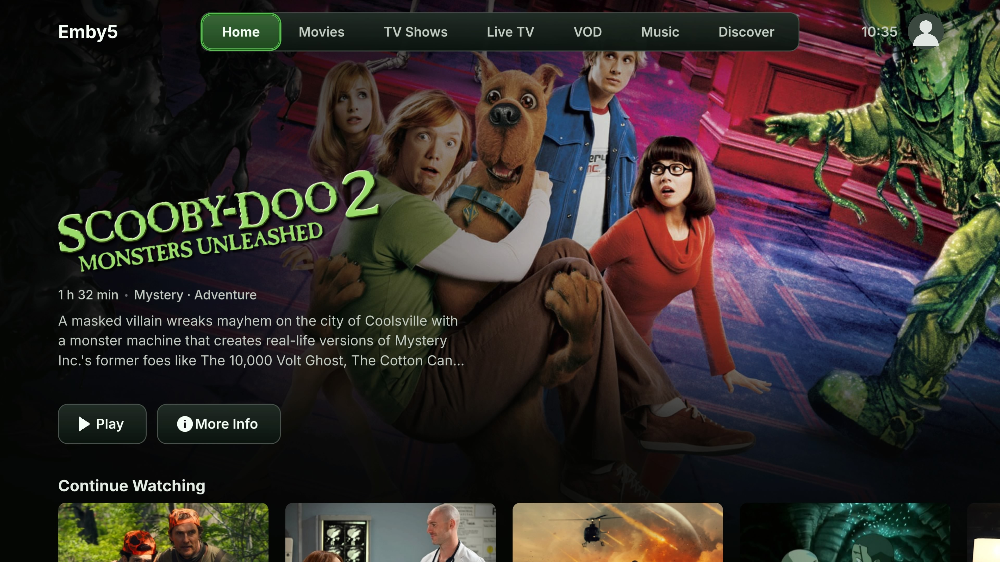

# Emby5 for PS5

**A native Emby and Jellyfin media client for homebrew-enabled PlayStation 5 consoles.**

**Emby & Jellyfin Libraries · Native PS5 Playback · Live TV · M3U/Xtream · VOD · 32 Visual Themes**

Emby5 is an unofficial native Emby and Jellyfin client for homebrew-capable PlayStation 5 consoles, derived from [Jelly5 by 02dnot](https://github.com/02dnot/Jelly5).

---

**Contents:** [Downloads](https://github.com/bornaradusin/Emby5/releases) · [Features](#features) · [Live TV](#live-tv--emby-xtream-and-m3um3u8) · [VOD](#video-on-demand-vod) · [HDMI Bitstream](#hdmi-audio-bitstream) · [Known Limitations](#known-limitations) · [Controls](#controls) · [Installation](#installation) · [Updating](#updating) · [Credits](#credits--acknowledgements) · [Licence](#licence) · [Disclaimer](#disclaimer-and-trademarks)


---

## Features

### Interface and Libraries

Emby5 provides a native, GPU-rendered interface designed for navigating your Emby and Jellyfin libraries on a television.

**Interface and customization**
- Native GPU-rendered PS5 interface.
- **32 selectable visual themes**, with near-black, bright-green Emby5 as the default for new settings.
- Theme-specific colors, panel treatments, borders, shadows, highlights, and bevels.
- Themes and other appearance options are available through the **Settings > System > Appearance** page.

**Browsing and navigation**
- Home screen with featured content, Continue Watching, Next Up, and Recently Added.
- Recommendations and genre browsing.
- Movies, TV shows, seasons, and episodes.
- Music libraries, artists, albums, and playlists.
- Media detail pages with artwork and metadata, readable full descriptions and a season/episode selector.
- **Trailer QR** on movie and series details when a suitable remote trailer link is supplied by the server; no Seerr connection is required.
- Upcoming episodes appear in TV Show season details.
- Main navigation: **Home · Movies · TV Shows · Live TV · VOD · Music · Discover**, with content-dependent tabs.
- Dedicated search within Live TV and VOD; the standalone main Search tab has been removed.
- Library sorting, filtering, favourites, and watched/unwatched status, synchronised with the connected server.
- A–Z library navigation.
- Artwork and backdrop loading, including placeholder rendering.
- Tile-based Settings screen for Accounts & Servers, Playback, Discover/Seerr, Live TV (including VOD settings), and System.
- Local storage for saved accounts and application settings.

**Note:** Some artwork may be unavailable or fail to load for particular items or libraries, depending on the connected server and image-handling behavior.

### Servers and Accounts

Connect to Emby or Jellyfin and manage accounts from both servers in the application.

- Local discovery sends requests for both server types.
- Manual HTTP/HTTPS server addresses, including reverse-proxy base paths.
- Server type is detected from public server information, not its custom name.
- Username/password authentication for both; Jellyfin Quick Connect when enabled by the server.
- Multiple saved users and servers, with backend and server identity stored per account.
- Account and server switching without sharing authentication tokens between providers.
- Existing account files remain compatible; older entries default to Emby and are checked on sign-in.

Compatibility depends on server configuration and available media formats.

Saved accounts and application settings are intended to survive normal application restarts and folder-based updates.

### Playback

Emby5 uses a native PS5 playback engine with hardware video decoding.

**Video and streaming**
- Hardware-accelerated H.264 and HEVC decoding, including supported 4K content.
- HEVC Main 10 support.
- HDR10 and HLG output for compatible media and displays.
- Direct Play, Direct Stream, and server-provided transcoding for Emby and Jellyfin.
- PS5-specific Emby playback negotiation and device profile.
- Media-source/version selection when multiple versions are available.
- **AV1 direct-play capability advertised to Emby for streams up to 4K, 10-bit, and 30 fps**, using the existing FFmpeg AV1 decoder.

**Video upscaling:** Off, Auto, FSR 1 and Anime4K are available in Playback settings. The active effect depends on the video path, output and available GPU resources; unsupported or memory-limited paths can fall back to native scaling.

**Playback controls**
- Audio-track and subtitle-track selection.
- Playback speed options: **0.75×, 1×, 1.25×, 1.5×, and 2×**.
- Audio delay adjustment.
- Night mode.
- Seeking and trickplay thumbnails where supported by the server.
- Improved audio/video synchronization after seeking and HLS timestamp handling.

**Playback information and continuity**
- Playback progress, resume, and watched-state reporting, with refreshes of related library rows after changes.
- Automatic reconnection attempts after some network or stream interruptions.
- Playback information accessible through **L3**, including available codec, delivery, and buffering details.

**Note:** Playback speeds and audio handling may be limited by the selected output mode. Automatic recovery is not guaranteed for every connection failure. AV1 software-decoding performance depends on the video and PS5 playback environment.

### Intros, Credits, and Episodes

Emby5 includes episode navigation and automatic playback features.

- Emby media-segment integration.
- Skip Intro and Skip Recap when suitable segments are provided by the server.
- Optional automatic intro skipping.
- Credits/outro handling and Watch Credits functionality.
- In-player season and episode browsing.
- Next-episode card and countdown.
- Automatic next-episode playback.
- Optional **Are You Still Watching?** confirmation for unattended episode autoplay.

#### Are You Still Watching?

Configure this feature under **Settings → Playback**.

| Setting | Behaviour |
| --- | --- |
| **Off** | Disabled by default |
| **After 3 episodes** | Counts the first selected episode; blocks episode four until a fresh X press |
| **After 2 hours** | Pauses at two hours of active playback; excludes pause, buffering and seek time |

At the confirmation, press **X** to continue or **Circle** to stop. Held/repeated
input, other buttons and queued remote skips do not accept it. Ordinary playback
controls do not permanently disable the prompt. Manual episode selection starts
a new chain; stream reopening preserves the current chain.

**This feature applies only to TV episode autoplay.** It does not affect music, IPTV, or movies.

### Audio and Subtitles

**Audio support**
- Playback of supported AAC, AC-3, E-AC-3, DTS-family, TrueHD, FLAC, Opus, MP3, and other FFmpeg-compatible audio formats, subject to codec and output limitations.
- Decoded PCM audio output for compatible formats.
- Optional HDMI bitstream output for supported AC-3, E-AC-3, and DTS-core streams.
- Audio-track selection while playing video.

**Subtitle support**
- Embedded and external subtitle tracks.
- Compatible text and bitmap subtitle formats, including SRT, ASS/SSA, PGS, DVD, DVB, and WebVTT.
- Subtitle-track selection and subtitle disabling during playback.
- Subtitle search and download when supported by the connected Emby server.
- Six Emby subtitle playback modes:
  - Default
  - Smart
  - Always
  - Only Forced
  - Hearing Impaired (SDH)
  - None

**Subtitle customization**

Subtitle customization is available through **Audio & Subtitles → Customize Subtitles** during playback.

- Adjust subtitle font size.
- Change subtitle vertical position.
- Select subtitle text colors: **white, yellow, cyan, and green**.
- Adjust subtitle background opacity.
- Customize subtitle outlines.
- Adjust subtitle delay in **0.1-second increments**, up to ±30 seconds.
- Reset subtitle customization settings to their defaults.
- Save subtitle appearance preferences locally.

Subtitle delay adjustments apply to the current playback session. Appearance customization depends on the selected subtitle format; some bitmap subtitles do not support text-style adjustments.

**Language preferences:** Emby5 uses subtitle preferences provided by the Emby server for automatic subtitle selection. Separate in-app preferred-language selectors are not included.

### Music

Browse and play music from Emby or Jellyfin.

- Artist, album, and playlist browsing.
- Music playback while navigating the application.
- Mini player and Now Playing screen.
- Playback queue navigation.
- Shuffle and repeat.
- Lyrics display when lyrics are available from Emby.

Album covers load in the background without switching tabs. Available album artwork is preferred; suitable track artwork can be used if the album cover fails. Missing covers retain a placeholder.

### Seerr (Optional)

Emby5 includes optional integration with supported Seerr servers for media discovery and requests.

**Connection and discovery**
- Seerr connection configuration and connection testing.
- Account-associated sessions.
- Seerr search and discovery integration.
- Trending, popular, and upcoming content discovery.

**Media requests**
- Movie requests.
- Television and season-based requests.
- Request-status viewing.
- Request withdrawal and additional-season requests where supported.
- Radarr/Sonarr configuration options, subject to server support and user permissions.
- Local storage of Seerr configuration.

**Note:** Available functions depend on the connected Seerr version, server configuration, and account permissions.

### Live TV — Emby, Xtream, and M3U/M3U8

Emby5 has a **Home-style Live TV screen**. Channels are displayed as horizontal logo cards, with one row per group or provider category.

**Sources and organisation**
- Native **Emby or Jellyfin Live TV** channels supplied by the connected server (including supported configured M3U tuners).
- **Xtream Codes** providers configured with server URL, username, and password.
- **M3U/M3U8** playlist URLs configured in Settings. An individual M3U8 HLS URL can represent a single playable stream rather than a multi-channel playlist.
- Channels from configured sources are combined in one Live TV screen, while retaining their provider-specific playback routes.
- Playlist `group-title` values and Xtream category names determine the horizontal rows (for example, Brazil, USA, Sports); no countries or genres are hard-coded.
- **Custom channel groups appear first** in their saved order, followed by provider and playlist groups. Channels can remain visible in their original groups.
- Channel logos are used when supplied; otherwise the channel name is shown.
- Previously discovered Live TV metadata may be restored from local cache. Actual playback requires a valid stream and available provider.
- The Live TV tab is hidden when no channels are available from configured sources.

Source-specific status and retry controls are in **Settings > Live TV**. Successful Xtream categories remain usable if another category fails; previous cached data is retained for failed requests. A complete successful refresh replaces obsolete entries.

**Guide and navigation**
- Now Playing and Up Next programme information, times and progress are shown when the source provides EPG data.
- Programme details are also available in the player overlay when controls are visible.
- Navigate **Left/Right** across channels in a row and **Up/Down** between rows.
- Press **X** to play the focused channel and **Triangle** to search loaded Live TV channels by name; **Circle** exits search.
- Custom category creation, channel assignments and ordering are managed from the **Live TV** Settings tile. Hold Up/Down to accelerate through the assignment list; assigning channels remains a separate action.
- EPG availability and stream compatibility depend on the provider; there is no complete interactive EPG grid.

**Note:** Emby5 does not provide channels, IPTV subscriptions, playlists, or credentials. Use sources you are entitled to access.

### Video on Demand (VOD)

Emby5 has a dedicated **VOD** section for supported Xtream catalogues and compatible standalone video entries from M3U playlists.

- Separate **Movies** and **TV Shows** areas with artwork, group/category rows and title browsing.
- Xtream series browsing includes seasons, episodes and episode playback when provider metadata is available.
- **Triangle** opens a VOD title search; search covers titles indexed in the locally stored catalogue, not just the currently visible cards.
- Progressive catalogue discovery and disk-backed metadata caching, with visible content read in bounded pages instead of copying an entire large catalogue into the UI.
- Previously cached items can appear on launch while catalogue refresh runs; newly discovered batches become available progressively.
- VOD is shown in main navigation only when at least one movie or series is available. Movies-only or TV-shows-only providers show the relevant area.
- **Settings > Live TV > VOD (at the bottom)** displays catalogue status and loaded title counts, offers manual refresh, and controls the automatic refresh interval: **Manual only, 12 hours, 24 hours (default), 48 hours, or 7 days**.
- Cached catalogue metadata reduces repeated downloads; a live provider connection may still be required to start playback.

Xtream movies and TV shows refresh independently, with separate counts, status and retries. A failed series request does not discard successful movie results. Cached content remains usable during refresh; incomplete results are not reported as a complete catalogue.

Press **Circle** to request cancellation while a stream is opening. A blocked native operation may need to return before the app can finish cancelling.

**Limitations:** Xtream API response sizes, provider category responses and available metadata can affect catalogue completeness. M3U entries do not necessarily include sufficient information to identify series, seasons or episodes; a video-file entry may appear as a standalone title. Large-library loading and compatibility vary by provider.

### Settings and Persistence

Settings tiles are **Accounts & Servers, Playback, Discover/Seerr, Live TV, and System**. VOD settings are at the bottom of **Live TV**; the main VOD browsing tab remains separate.

```text
System
|-- Appearance
|-- What's New
|-- Check for updates     On / Off
|-- Installed version
|-- Connected server
`-- Persistent storage
```

There is no separate About page. Connected server and Persistent storage are read-only information rows.

**Check for updates** defaults to **On**. It controls automatic release checks and the PS5 kernel update-available notification. Off suppresses pending update notifications too. At most one notification is shown for the same newer version per app launch. Up-to-date results and failed automatic checks do not produce unsolicited update notices.

**What's New** remains available manually while automatic checks are off. No update package is downloaded or installed by the app. Genuine playback and connection-error notifications are not disabled by this switch.

The interface follows the PS5 console language where supported, with English fallback; there is no separate interface-language selector.

Configuration and cache data are kept separately from the installation under **`/data/Emby5/`**, including `config/`, `cache/images/` and `logs/`. Preserve this directory during updates. Existing options such as intro skipping, autoplay, Night Mode, refresh rate and provider configuration remain in their relevant categories.

### Visual Themes

Open **Settings > System > Appearance** to customise the interface.

There are **32 selectable themes**: **Emby5**, the default for new settings with near-black backgrounds, dark glass surfaces and bright green accents; the original blue **Glass**; and **30 additional themes** inspired by [BlackBearReloaded's PS5 Homebrew UI](https://github.com/blackbearreloaded/ps5-homebrew-ui).

Existing saved appearances are retained. Select **Emby5** and Apply to adopt the new default. Choosing a preset resets the draft overrides without deleting your saved custom themes.

| Appearance section | Available controls |
| --- | --- |
| **Themes & Colours** | Preset, coordinated colour variant and accent colour. |
| **Buttons & Panels** | Button shape, Theme default/Solid/Glass material, and Normal/Strong selection outline. |
| **Background** | Background colour, artwork/plain background and backdrop dimming. |
| **Text & Browsing Layout** | Interface text at 90%, 100%, 110% or 120%; Compact/Default/Large posters and cards. |
| **Motion & Reading** | Selected-poster enlargement, reduced motion and Off/Slow/Normal description scrolling. |
| **Content Display** | Unwatched-episode spoiler protection, logo/text titles and detail-poster visibility. |
| **Preview** | Buttons/navigation, library, details and playback-control samples; compare the draft with the last applied appearance. |
| **Saved Custom Themes** | Save, load and rename three slots; confirm before replacing an occupied slot. |
| **Apply & Recovery** | Apply, discard, restore the last applied appearance or reset the selected preset. |

**Button shapes:** Theme default, Square corners, Slightly rounded, Rounded, Pill / oval-ended and Angled corners. Button backgrounds, outlines and shadows follow the chosen shape; posters and avatars retain their own geometry.

**Background colours:** Theme default, Black, Dark, Light, Midnight blue, Ocean blue, Deep teal, Forest green, Royal purple, Plum, Burgundy, Warm brown and Slate blue. Coordinated variants and explicit accent overrides remain separate from shape and material.

**Saving:** Changes are a draft until you Apply. **Options** applies the draft; leaving with unsaved changes offers Apply / Discard / Keep editing. Saved custom slots and their names are also saved on Apply. Reset affects appearance only, not accounts, provider settings or playback preferences.

**Reading:** Full descriptions remain accessible with **Square**, even when automatic scrolling is off. For protected episode details, Square first reveals the spoiler without marking it watched. Reduced motion disables automatic description movement. Logo titles fall back to text when the server has no usable logo.

Appearance is local to Emby5: it does not modify Emby/Jellyfin website themes or other clients. Background dimming does not change video brightness or HDR, and interface text size does not change subtitle sizing.

These themes use Emby5's native PS5 renderer. They are adaptations, not exact reproductions of the original theme projects.

### PS5 Integration

- Native PS5 application title ID: `PPSA99515`.
- DualSense controller navigation.
- Adaptive-trigger seeking support.
- DualSense light-bar integration.
- HDMI Device Link / HDMI-CEC input handling where supported.
- Optional 120 Hz UI output on compatible displays and PS5 configurations.
- Folder-based homebrew installation and updating.
- Optional update notifications and manual release notes in Settings > System; no update installer.

**Note:** Hardware-dependent features may behave differently across PS5 firmware versions and homebrew environments.

---

## HDMI Audio Bitstream

Emby5 1.0.0 includes optional HDMI bitstream handling for compatible audio streams.

| Format | Description |
| --- | --- |
| **AC-3** | Dolby Digital |
| **E-AC-3** | Dolby Digital Plus |
| **DTS core** | DTS core audio |

When bitstream output is unavailable or unsupported, the player attempts to use decoded PCM audio instead.

- Night mode disables bitstream output.
- TrueHD Atmos and DTS:X bitstream passthrough are not supported.

**Compatibility:** HDMI bitstream support is implemented in source, but compatibility with individual receivers, televisions, and audio configurations requires hardware testing.

---

## Known Limitations

The following limitations relate to the PS5 platform, the homebrew environment, or Emby5's current implementation.

**Audio and video**
- HDMI bitstream output requires compatible equipment and source formats.
- TrueHD Atmos and DTS:X bitstream passthrough are not supported.
- Dolby Vision compatibility depends on the source profile and playback path. Native Dolby Vision output is not supported, and some files may require server transcoding.
- AV1 direct-play support is advertised for streams up to **4K, 10-bit, and 30 fps**, using FFmpeg software decoding rather than the intended hardware video-decoding path. Actual playback performance varies; incompatible streams may require server transcoding.
- Native stereoscopic 3D output is not supported. Side-by-side and top-and-bottom 3D content is rejected by the application.

**Application limitations**
- Emby5 cannot terminate itself. Use the PS button to close it.
- Subtitle appearance customization depends on the subtitle format and is not available for all bitmap subtitle types.
- Separate preferred audio-language and subtitle-language selectors are not included; automatic subtitle selection follows supported Emby server preferences.
- EPG depends on the channel provider supplying programme information; a full interactive TV-guide grid is not included.
- The completeness and playback compatibility of third-party IPTV/VOD catalogues depends on the provider and source format.

---

## Controls

Emby5 is designed for navigation using the DualSense controller.

| Button | Menus | Player |
| --- | --- | --- |
| **X** | Select | Play / pause / select |
| **Circle** | Back | Hide controls / leave player |
| **D-pad** | Navigate | Full-screen Live TV: Up/Down groups, Left/Right channels; visible menus and non-live playback retain normal navigation/seek controls |
| **L1 / R1** | Previous / next tab | Seek backward / forward |
| **L2 / R2** | Previous / next A–Z letter | Adaptive rewind / fast-forward |
| **Triangle** | Search in Live TV/VOD where available | Episodes |
| **Square** | Sort/filter; detail pages: Read more or reveal protected episode details | Audio and subtitle selection |
| **Options** | Item options | Playback controls |
| **Touchpad** | Now Playing while music plays | Playback controls |
| **L3** | — | Playback information |

Live TV uses Left/Right to browse channels within a group and Up/Down to move between group rows. During full-screen Live TV playback with controls hidden, **Up** plays the first channel of the previous group and **Down** the first channel of the next group; **Left/Right** plays the previous/next channel within the current group. The order follows the displayed groups (saved custom groups first). Empty groups are skipped; groups and channels wrap at the ends. One fresh press makes one switch; held/repeated input does not skip multiple streams. **Options** opens playback controls; **Circle** hides them, and visible menus keep normal directional navigation. Switching completes the old player and server stop/stream cleanup before opening the next stream. Triangle opens Live TV or VOD search when supported. Some buttons have additional functions in custom-group management.

---

## Installation

### Installing Emby5

1. Download `Emby5-<version>.zip` from [GitHub Releases](https://github.com/bornaradusin/Emby5/releases).
2. Extract the downloaded ZIP.
3. Upload the included `PPSA99515/` folder to `/data/homebrew/` on the PS5.
4. Verify that the installation contains:

   `/data/homebrew/PPSA99515/eboot.bin`

5. If required by your ShadowMountPlus setup, set the `PPSA99515/` directory and its contents recursively to permission **777**.
6. Allow ShadowMountPlus approximately **15 seconds** to discover the application. If it does not appear, redeploy ShadowMountPlus and allow it to scan `/data/homebrew/` again.

### File Transfer Recommendation

For manual transfers, [ps5-web-file-manager by owendswang](https://github.com/owendswang/ps5-web-file-manager) or another compatible file-management tool is recommended.

After transferring, confirm that the installed application files have the required **0777 permissions** for your homebrew environment.

---

## Updating

1. Close Emby5 completely and back up the working installation and `/data/Emby5/`.
2. Download the desired `Emby5-<version>.zip` from [GitHub Releases](https://github.com/bornaradusin/Emby5/releases) and extract it.
3. Copy the included `PPSA99515/` files over `/data/homebrew/PPSA99515/`.
4. **Do not delete `/data/Emby5/`.** Launch the app and check Installed version under **Settings > System**.

Accounts, preferences, Seerr configuration and catalogue caches are separate from the installed application files. Previous sandbox-stored settings are not automatically migrated; older installations may require reconfiguration.

Updates are installed manually. **Settings > System > Check for updates** controls release notifications only, and **What's New** opens release notes. Neither downloads nor installs an update.

---

## Building from source

Run from the repository root with a configured PS5 payload SDK, its homebrew
sysroot, LLVM/Clang, GNU build utilities and Python 3. You can use an existing
SDK by setting `PS5_PAYLOAD_SDK`, `LLVM_CONFIG`, `PS5_LLD` and your `PATH`, or
set up the repository-local toolchain:

```bash
bash scripts/setup-toolchain.sh
eval "$(bash scripts/setup-toolchain.sh --env)"
(cd app && bash scripts/build.sh --release)
```

The installable ZIP is written to `app/build/app/Emby5-<version>.zip`.
Build products are local and must not be committed. Nothing is uploaded or
copied to another machine automatically.

Existing assets are checked against `app/assets/font-assets.json`. A complete
checkout builds using its own assets. For a source archive missing those assets,
explicitly set `EMBY5_ASSET_SOURCE` to an asset-source ZIP containing the original
`Emby5/app/assets/fonts/` entries. No machine-specific fallback path is used.

---

## Credits & Acknowledgements

Emby5 builds upon and draws inspiration from the work of developers throughout the PlayStation 5 homebrew and open-source communities.

Full credit for the original projects and components belongs to their respective developers and contributors.

### Jelly5 — Original Application Inspiration

**[02dnot — Jelly5](https://github.com/02dnot/Jelly5)**

Credit for initial idea and work.

### Nuvio PS5 — Application and Playback Foundations

**[Husam Osman / theghostonline — Nuvio PS5](https://github.com/theghostonline/Nuvio-PS5)**

Credit for upstream PlayStation 5 application and playback foundations.

### EVO Player PS5 — Native Media Engine

**[sainsaji — EVO Player PS5](https://github.com/sainsaji/EVO-PLAYER-PS5)**

Credit for native PS5 media playback, decoding, rendering, and media-engine foundations.

### ProsperoTV — IPTV Reference and Inspiration

**[BlackBearReloaded — ProsperoTV](https://github.com/blackbearreloaded/ProsperoTV)**

Creator of ProsperoTV, a native PlayStation 5 IPTV homebrew application.

ProsperoTV is acknowledged as a reference and inspiration for IPTV development in Emby5.

### PS5 Homebrew UI — Visual Theme Designs

**[BlackBearReloaded — PS5 Homebrew UI](https://github.com/blackbearreloaded/ps5-homebrew-ui)**

Creator of the UI theme collection that inspired the 30 additional Emby5 visual themes.

The original styling concepts and visual designs have been adapted to Emby5's native AGC rendering system.

Full credit for the original theme designs belongs to BlackBearReloaded.

### PS5 SDK and Toolchain

**[ps5-payload-dev — PS5 Payload SDK](https://github.com/ps5-payload-dev/sdk)**

Open-source PlayStation 5 SDK and development tools.

**PacBrew**

PS5 homebrew toolchain and package ecosystem.

### Open-Source Libraries

Thanks to the developers and maintainers of the open-source libraries used by Emby5 and its upstream projects, including:

- FFmpeg
- libass
- FreeType
- HarfBuzz
- cJSON
- NanoSVG
- OpenSSL
- libcurl
- zlib

Thanks also to everyone contributing to the wider PS5 homebrew community.

For additional attribution and third-party licensing information, see [THIRD_PARTY_NOTICES.md](THIRD_PARTY_NOTICES.md).

---

## Licence

Emby5 is distributed under the **GNU General Public License v3.0 or later**. See [LICENSE](LICENSE).

Third-party components remain subject to their respective licences and copyright notices.

---

## Disclaimer and Trademarks

Emby5 is unofficial homebrew software provided **without warranty**.

The application does not include media files, IPTV channels, subscriptions, or access credentials.

Users are responsible for accessing media and services they are legally entitled to use.

Emby5 is not affiliated with or endorsed by Emby LLC, Sony Interactive Entertainment, Jelly5, or any of the other acknowledged upstream projects.

*Emby*, *PlayStation*, *PS5*, and *DualSense* are trademarks or names belonging to their respective owners and are used solely to describe compatibility.
